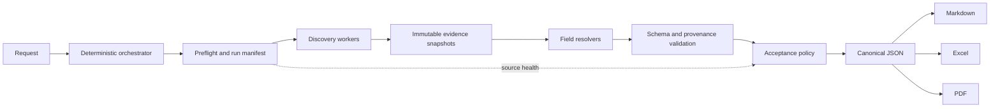

# Hermes Market Research Agent

Hermes Market Research Agent is a local-first research pipeline that discovers businesses and turns public web evidence into structured lead records. It separates discovery, reading, resolution, validation, approval, and rendering so that missing or inaccessible data is reported instead of guessed.

Version 0.1 is intentionally bounded to at most 60 businesses per run. It is a research tool, not a messaging or outreach system.

## Architecture



Workers run in isolated Docker containers by default. The run manifest records the backend, image digest, effective resource limits, attempts, evidence, failures, field coverage, and final state.

## Docker quickstart

Requirements: Docker with a running daemon and Python 3.11+.

Cloning this repository is not enough to give you Hermes, and this repository does not vendor it: Hermes is a separate upstream project, pinned in `requirements.lock` to an immutable commit rather than copied here. What you still need depends on the backend you run:

- **Docker (the default).** Nothing extra. Hermes is already inside the pinned worker image — `Dockerfile.worker` builds `FROM nousresearch/hermes-agent@sha256:9774f4f3…` — so you need only a running Docker daemon and network access to pull that image once.
- **Local (an explicit opt-in).** Installing the lock file does put the pinned Hermes package in the virtualenv (`venv/src/hermes-agent`, with a `hermes` CLI in `venv/bin`), but it configures no Hermes home, and the pipeline looks for the checkout at `LEADGEN_HERMES_ROOT` — by default `$HERMES_HOME/hermes-agent`, which is not where `pip` put it. Either point `LEADGEN_HERMES_ROOT` at your Hermes checkout (for example `$PWD/venv/src/hermes-agent`), or install and configure Hermes separately. Before a local run starts, `app/execution.py` requires the directory at that path to exist, `hermes_cli` to be importable, and a working `hermes` CLI to be on `PATH` — so activate the virtualenv or otherwise put `venv/bin` on `PATH`. See the upstream project at <https://github.com/NousResearch/hermes-agent> and its documentation at <https://hermes-agent.nousresearch.com/docs>.

Copy `.env.example` to `.env`, then provide only the credentials and paths needed by your environment. Never commit `.env`.

```sh
python3.11 -m venv venv
venv/bin/pip install -r requirements.lock
docker build -f Dockerfile.worker -t leadgen-worker:local .

export LEADGEN_PYTHON="$PWD/venv/bin/python"

# `orchestrate spec` names its output after the wall-clock time it was created
# (specs/generated/leadgen-<YYYYmmdd-HHMMSS>.yaml), so the filename cannot be
# written down in advance. Read the path back out of its JSON instead.
SPEC=$(./orchestrate spec \
  "Find 5 spas in Dubai Marina, AE. No outreach. Generate Markdown, Excel and PDF." \
  | "$LEADGEN_PYTHON" -c 'import json,sys; print(json.load(sys.stdin)["spec_path"])')

./leadgen start "$SPEC"
```

`./orchestrate spec` prints JSON and generates nothing else; the path it reports is the one to pass on, quoted.

Docker is the default backend. Local execution must be selected explicitly and performs additional Hermes health and update-lock checks.

## Request examples

Country is mandatory and must be an ISO 3166-1 alpha-2 code. The area is preserved as entered.

```text
Find 5 spas in Dubai Marina, AE. No outreach.
Find twenty five bookshops in Edinburgh, GB. Generate Markdown and Excel.
Find 60 cafes in Ubud, ID. I need Google rating, review count and public contact.
```

Counts from 1 through 60 are accepted. Larger runs are outside the verified v0.1 operating envelope.

## Field status model

| Status | Meaning | Resolved? | Failed for coverage? |
|---|---|---:|---:|
| `found` | A value is supported by field-specific evidence. | Yes | No |
| `not_public` | The source was accessible and indicates the field is not publicly available. | Yes | No |
| `not_found` | Accessible sources were checked but did not establish the value. | No | Yes |
| `ambiguous` | Evidence conflicts or cannot be tied safely to one business. | No | Yes |
| `access_restricted` | Login, limited-view, rate-limit, or access controls prevented observation. | No | Yes |
| `error` | The field could not be evaluated because processing failed. | No | Yes |

`access_restricted` is deliberately distinct from `not_public`: inability to access a source says nothing about whether a business publishes the field.

## Acceptance policy

The default policy is stored in `acceptance-policy.json`.

- Gate fields: `google_rating`, `google_review_count`, `public_contact`; each requires at least 70% resolved coverage.
- Soft fields: `instagram`, `whatsapp`; shortfalls produce warnings.
- Informational fields: `owner`, `dm_proxy`; they never gate approval.
- `approved`: every gate passes and no task exhausted its iteration budget.
- `partial_success`: the run completed, but a gate failed or a task exhausted iterations.
- `failed`: a structural, infrastructure, or count failure prevented a valid completed run.

Coverage reports `found`, `not_public`, `not_found`, `ambiguous`, `access_restricted`, and `error` separately. Restricted access is included in failed coverage, never resolved coverage. Source health reports pages that were OK or restricted and whether a source became degraded or blocked.

## Known limitations

These are observed results, not performance guarantees.

| Run | Request | State | Useful cells | Material limitations |
|---|---|---|---:|---|
| `run-20261010-191710` | 5 spa/wellness businesses, Canggu, ID | `partial_success` | 60% | Google review count resolved 0%; Instagram 20%; WhatsApp 40%; owner 0%; `find-web` and `read-reviews` exhausted iterations. |
| `run-20261010-193927` | 5 spas, Dubai Marina, AE | `partial_success` | 25% | Names resolved 100%, but Google rating, Google review count, and public contact resolved 0%; Instagram and WhatsApp resolved 0%; `read-ig` exhausted iterations. |
| `run-20261011-010910` | 5 spas, Dubai Marina, AE (Docker backend) | `partial_success` | 42.5% | Names and `dm_proxy` resolved 100%; Google review count 100% `access_restricted` (0% resolved); Google rating, public contact and WhatsApp 40% `access_restricted`; Instagram 20% resolved; owner 0%; `find-maps-r2` exhausted iterations. Google blocked the Maps source after 3 restricted pages. |

The Dubai runs encountered a limited Google Maps view. In releases with source-health accounting this condition is reported as `access_restricted`, degrades the Google source, and fails affected coverage; it must not be interpreted as `not_public` or as proof that the value does not exist. Once a source becomes `blocked` (three consecutive restricted pages in `run-20261011-010910`), the orchestrator stops dispatching any further task that reads that source and records the batches it would have run as `access_restricted`, citing the snapshot that established the block. Browser-based sources can vary by geography, session, consent page, rate limiting, and source UI changes.

## Responsible use

Use this project only for information made publicly accessible by its source. Do not use it for outreach, messaging, account login, access-control circumvention, or collection from private pages. The project disables DM probing and does not send messages.

Automated access may be restricted by Google Maps, Instagram, or other providers. Review the applicable provider terms, robots guidance, rate limits, and your intended use before running research. If a source blocks or limits access, respect that signal.

Owner names, phone numbers, and WhatsApp identifiers may be personal data even when publicly displayed. Collect only what is necessary, retain it for no longer than needed, control access to outputs, and review the data-protection requirements that apply to your context. This project does not make a legal-compliance determination for you.

## Fixture data and removal requests

Tests and examples in this repository use a small amount of **public business fixture data**: business names, public phone numbers, public addresses, public social handles, public URLs, Google result snippets, and the timestamps at which those pages were retrieved. It exists so that the suite and the examples can run without live browsing. It is limited to information already publicly displayed by its source, and it contains no credentials, API keys, tokens, cookies, private keys, machine names, or non-public personal data.

If you own one of these businesses, or you are a person named in a fixture, and you want the entry removed, open an issue titled `fixture removal request` naming the exact record (business name and the file it appears in). No justification is required. The record is removed in the next release; if the fixture is referenced by a test, the test is moved to synthetic data at the same time. The same channel serves any correction to fixture data that is inaccurate or no longer public.

## Development

See [CONTRIBUTING.md](CONTRIBUTING.md), [SECURITY.md](SECURITY.md), and [docs/v0.2-source-provider.md](docs/v0.2-source-provider.md). Licensed under the Apache License, Version 2.0; see [LICENSE](LICENSE).
